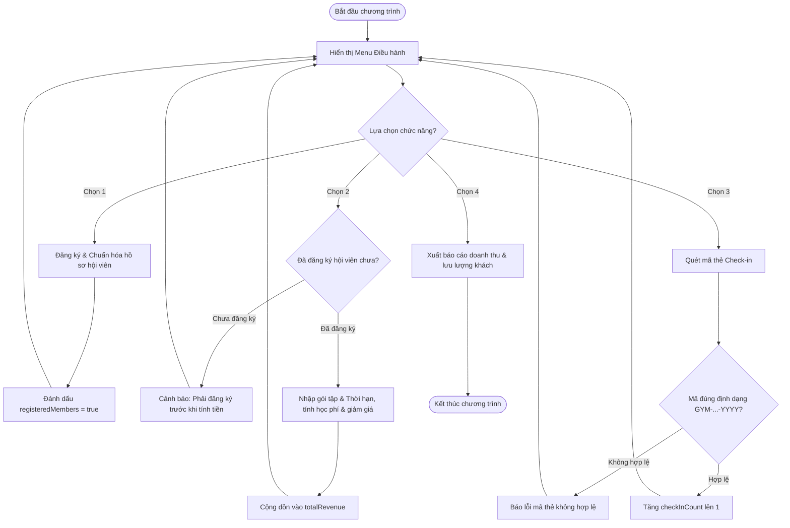

# BÁO CÁO BÀI TẬP: XÂY DỰNG KHUNG MENU ĐIỀU HÀNH & HỆ THỐNG XỬ LÝ DỮ LIỆU HỘI VIÊN GYM

> 👤 **Học viên:** Hoàng Công Dũng | **Mã SV:** PTIT-HCM-009
> 🏫 **Môn học:** it103b-rl-HoangCongDung

---

## 📊 Sơ đồ thiết kế hệ thống (Activity Diagram)

> 💡 *Sơ đồ dưới đây được render tự động trực tiếp trên GitHub bằng Mermaid. Bạn cũng có thể tải file **`bt2.drawio`** trong repository này để mở và chỉnh sửa trực tiếp trên [Draw.io (diagrams.net)](https://app.diagrams.net).* 

---

## 1. Mục tiêu và Bối cảnh bài toán

Bài tập yêu cầu tự tay xây dựng một ứng dụng dòng lệnh (CLI) bằng JavaScript thuần sử dụng vòng lặp do-while kết hợp cấu trúc nhánh switch-case để giải quyết bài toán vận hành thực tế tại lễ tân phòng Gym Fitness.

Hệ thống giúp tự động hóa việc đăng ký hội viên, chuẩn hóa thông tin chuỗi, tính toán gói tập linh hoạt kèm chính sách chiết khấu theo thời gian, đồng thời kiểm soát lượt ra vào cửa bằng cơ chế quét mã thẻ định dạng chuẩn.

- Duy trì trạng thái các biến số quan trọng gồm registeredMembers, totalRevenue, checkInCount qua từng vòng lặp.
- Áp dụng quy tắc kiểm tra logic nghiêm ngặt: Chặn tuyệt đối việc tính tiền (Chức năng 2) nếu hội viên chưa thực hiện đăng ký (Chức năng 1).

## 2. Phân tích Quy tắc Nghiệp vụ và Xử lý Bẫy Dữ liệu

Để đảm bảo chương trình không bị lỗi logic và vận hành trơn tru trong môi trường thực tế, các quy tắc nghiệp vụ đã được xử lý chi tiết trong mã nguồn:

Chiết khấu học phí được tính tự động dựa trên số tháng đăng ký: từ 6 tháng đến dưới 12 tháng giảm 15%, từ 12 tháng trở lên giảm 25%. Phí thuê PT kèm riêng được cộng thêm cố định 300.000 VNĐ cho mỗi buổi.

- Quy tắc mã thẻ check-in: Phải bắt đầu bằng chuỗi 'GYM-' và kết thúc bằng năm hiện tại (ví dụ: 'GYM-VIP-2025'). Sử dụng biểu thức chính quy (Regex) hoặc hàm kiểm tra chuỗi 'startsWith' và 'endsWith' để xác thực.
- Quản lý trạng thái: Biến cờ 'registeredMembers' đóng vai trò khóa bảo vệ nghiệp vụ, bắt buộc người dùng phải qua bước 1 trước khi được phép sang bước 2.

## 3. Bảng đặc tả chi tiết quy trình Menu Điều hành

Bảng tổng hợp chi tiết chức năng và điều kiện thực thi của từng tùy chọn trong Menu:

| Chức năng Menu | Tên nhiệm vụ | Thao tác thực hiện | Kiểm tra điều kiện & Kết quả |
| --- | --- | --- | --- |
| 1 | Đăng ký hội viên | Nhập thông tin tên, chọn gói tập (STANDARD/VIP) | Chuẩn hóa chuỗi và chuyển cờ registeredMembers thành true |
| 2 | Tính tiền gói tập | Nhập số tháng, tùy chọn thuê PT | Kiểm tra nếu chưa đăng ký thì báo lỗi, ngược lại tính tiền và cộng dồn doanh thu |
| 3 | Quét mã thẻ check-in | Nhập chuỗi mã thẻ hội viên tại cửa quay | Kiểm tra định dạng 'GYM-...-YYYY', nếu hợp lệ tăng biến đếm checkInCount |
| 4 | Xuất báo cáo & Thoát | In tổng kết tài chính và lưu lượng khách | Hiển thị tổng doanh thu và tổng số lượt check-in trong ca trực, thoát vòng lặp |

## 4. Đánh giá sơ đồ thiết kế hệ thống

Sơ đồ Activity Diagram TO-BE đã mô phỏng trực quan toàn bộ vòng đời của ứng dụng từ lúc khởi động cho đến khi kết thúc ca trực.

Các luồng rẽ nhánh điều kiện (Decision) được thiết kế chặt chẽ giúp bảo vệ hệ thống khỏi các dữ liệu đầu vào không hợp lệ từ người dùng.

---

## 📁 Danh sách tệp tin nộp bài trong Repository
- 📝 `bt2.docx`: Báo cáo tài liệu phân tích nghiệp vụ hoàn chỉnh.
- 🎨 `bt2.drawio`: File thiết kế sơ đồ chuẩn theo quy định đề bài (mở trực tiếp bằng [Draw.io](https://app.diagrams.net) hoặc Lucidchart).
- 💻 `practice_gym_membership.js`: Mã nguồn chương trình.
